# TRUSTA STUDIO · 전체 결과 모음

이 페이지 하나에서 지금까지 만든 것을 모두 열 수 있습니다. 설치나 서버 실행 없이 주소를 누르면 바로 열립니다.

## 1. 바로 보기

| 화면 | 주소 |
|---|---|
| 메인 홈페이지 | [https://geben147-create.github.io/trusta-studio/](https://geben147-create.github.io/trusta-studio/) |
| 영상 전용 페이지 | [https://geben147-create.github.io/trusta-studio/video.html](https://geben147-create.github.io/trusta-studio/video.html) |
| 와디즈 페이지 시안 (기존 원본) | [https://geben147-create.github.io/trusta-studio/wadiz/](https://geben147-create.github.io/trusta-studio/wadiz/) |

## 2. 영상

| 영상 | 바로 재생 |
|---|---|
| 메인 쇼릴 | [https://geben147-create.github.io/trusta-studio/assets/video/hero_showreel.mp4](https://geben147-create.github.io/trusta-studio/assets/video/hero_showreel.mp4) |
| 햄찌 오피스 코미디 | [https://geben147-create.github.io/trusta-studio/assets/video/hamster_office_16x9.mp4](https://geben147-create.github.io/trusta-studio/assets/video/hamster_office_16x9.mp4) |
| 햄찌 사진관 | [https://geben147-create.github.io/trusta-studio/assets/video/hamzzi_office_9x16.mp4](https://geben147-create.github.io/trusta-studio/assets/video/hamzzi_office_9x16.mp4) |
| 햄찌 EP.01 | [https://geben147-create.github.io/trusta-studio/assets/video/hamzzi_ep01_9x16.mp4](https://geben147-create.github.io/trusta-studio/assets/video/hamzzi_ep01_9x16.mp4) |
| 일본 고객용 SNS 릴스 | [https://geben147-create.github.io/trusta-studio/assets/video/sns_character_short.mp4](https://geben147-create.github.io/trusta-studio/assets/video/sns_character_short.mp4) |
| 콘텐츠 노트 모션카드 | [https://geben147-create.github.io/trusta-studio/assets/video/sns_motion_card.mp4](https://geben147-create.github.io/trusta-studio/assets/video/sns_motion_card.mp4) |

## 3. 디자인 이미지

| 미리보기 | 원본 크기 주소 |
|---|---|
| 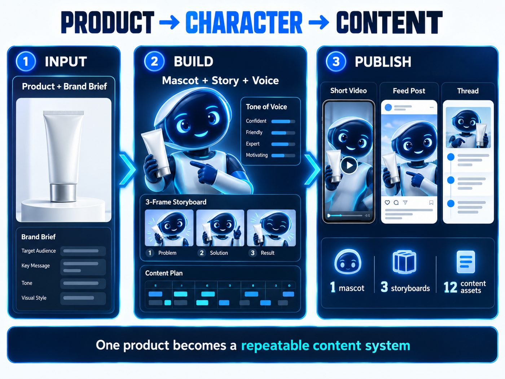 | [https://geben147-create.github.io/trusta-studio/assets/work/auto-product.jpg](https://geben147-create.github.io/trusta-studio/assets/work/auto-product.jpg) |
| 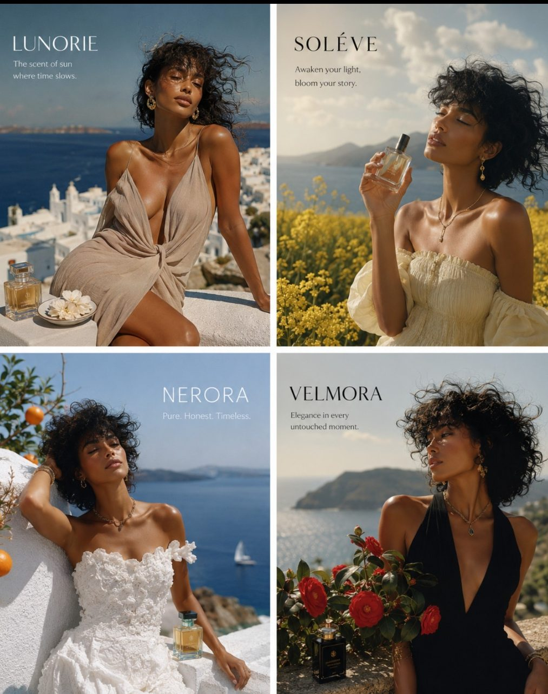 | [https://geben147-create.github.io/trusta-studio/assets/work/beauty-coast.jpg](https://geben147-create.github.io/trusta-studio/assets/work/beauty-coast.jpg) |
| 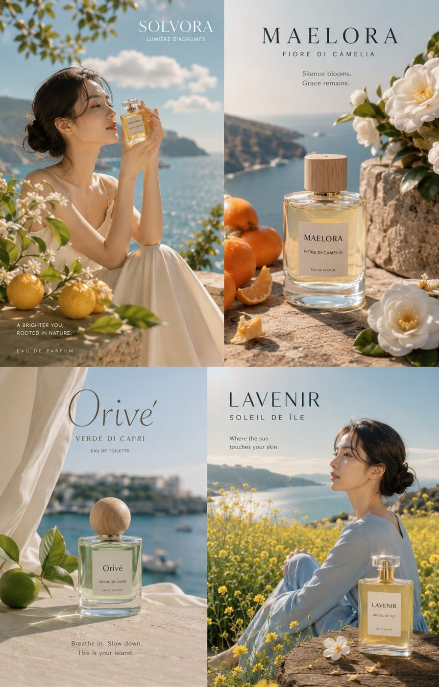 | [https://geben147-create.github.io/trusta-studio/assets/work/beauty-island.jpg](https://geben147-create.github.io/trusta-studio/assets/work/beauty-island.jpg) |
|  | [https://geben147-create.github.io/trusta-studio/assets/work/beauty-peach.jpg](https://geben147-create.github.io/trusta-studio/assets/work/beauty-peach.jpg) |
| 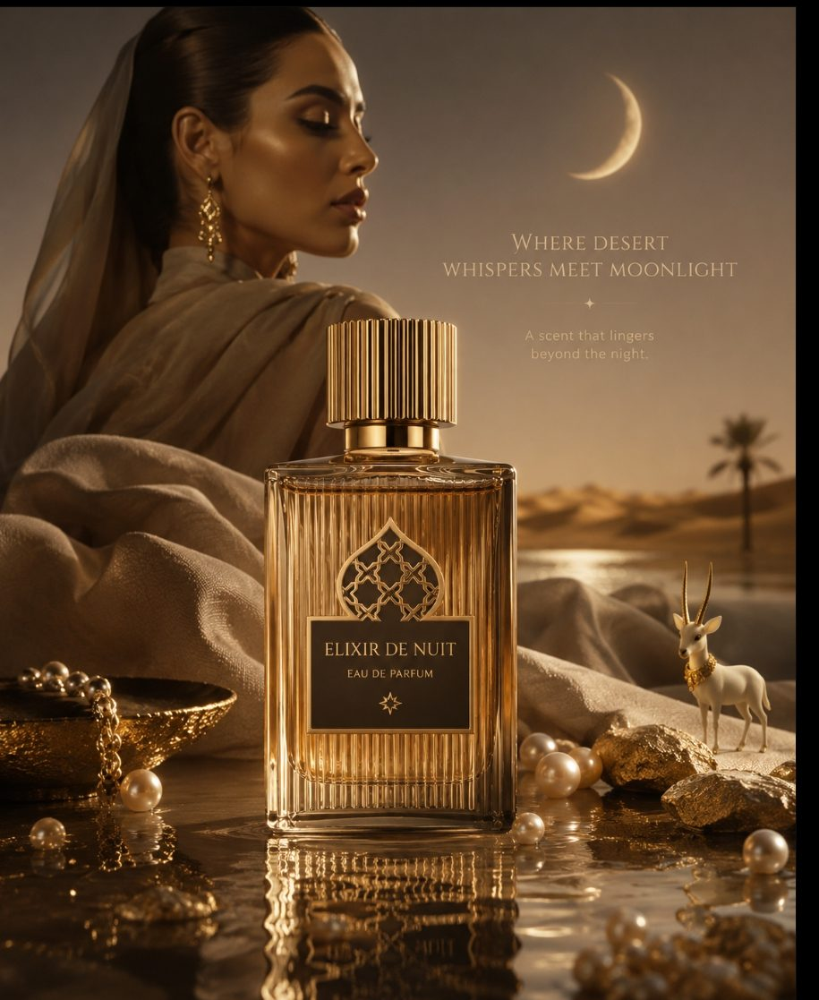 | [https://geben147-create.github.io/trusta-studio/assets/work/beauty-perfume.jpg](https://geben147-create.github.io/trusta-studio/assets/work/beauty-perfume.jpg) |
| 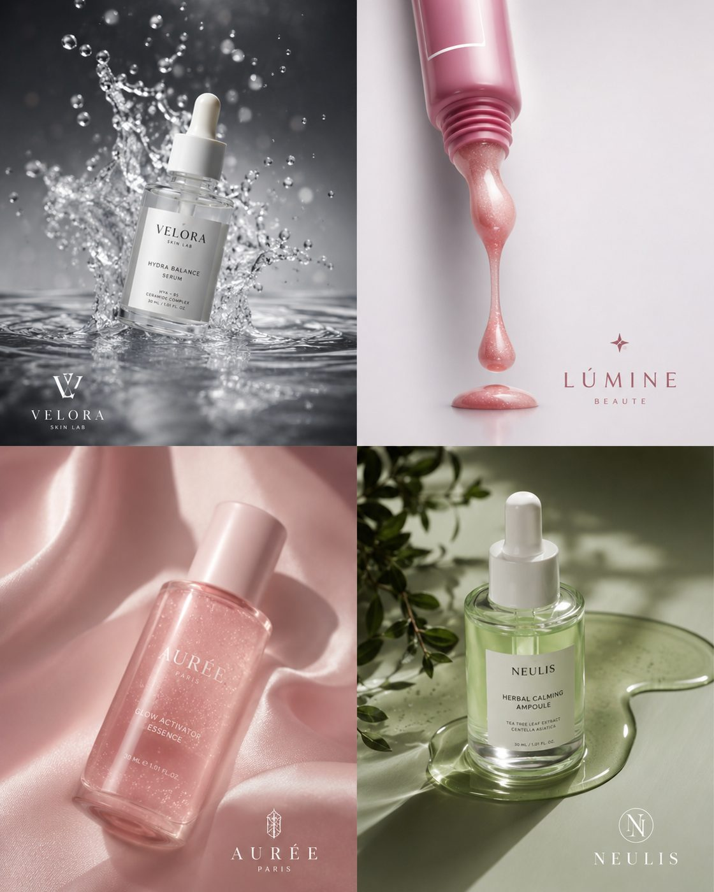 | [https://geben147-create.github.io/trusta-studio/assets/work/beauty-pink.jpg](https://geben147-create.github.io/trusta-studio/assets/work/beauty-pink.jpg) |
| 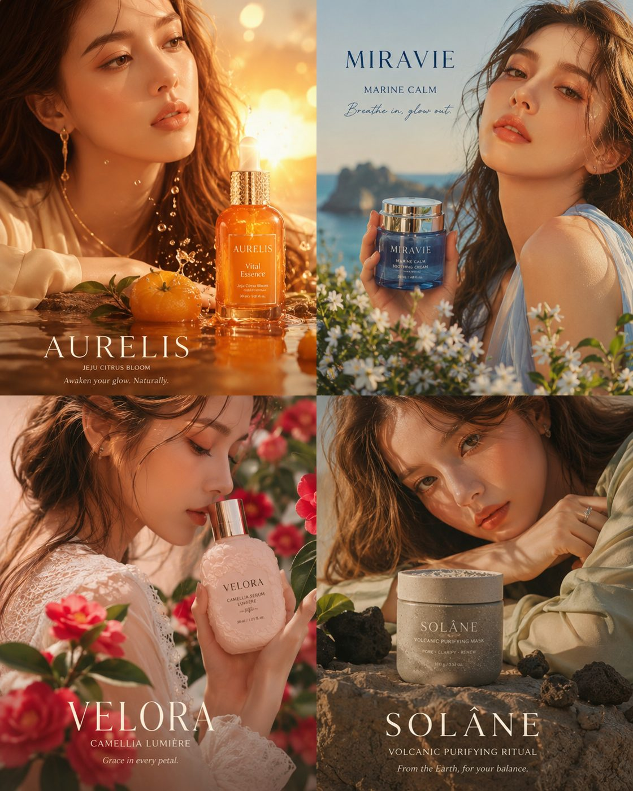 | [https://geben147-create.github.io/trusta-studio/assets/work/beauty-sun.jpg](https://geben147-create.github.io/trusta-studio/assets/work/beauty-sun.jpg) |
| 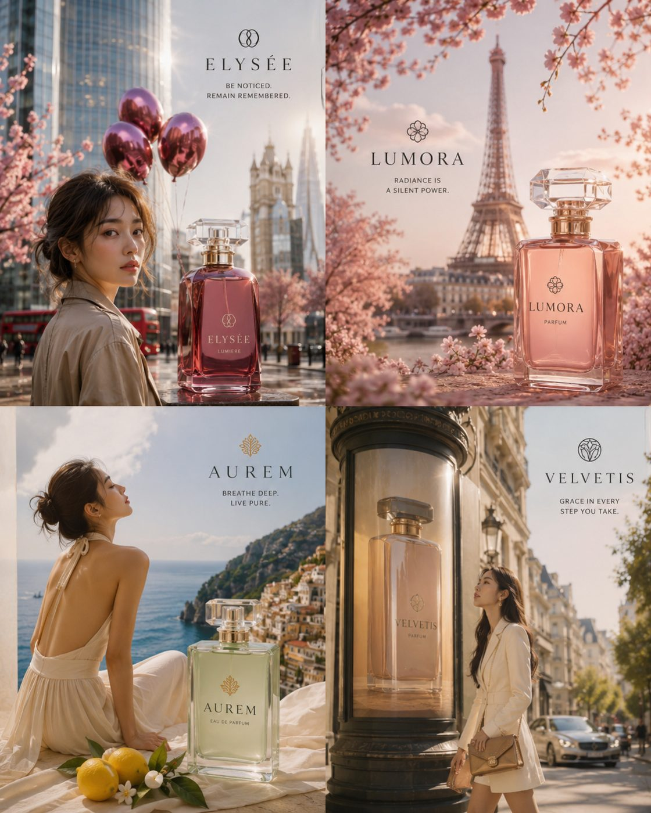 | [https://geben147-create.github.io/trusta-studio/assets/work/beauty-travel.jpg](https://geben147-create.github.io/trusta-studio/assets/work/beauty-travel.jpg) |
| 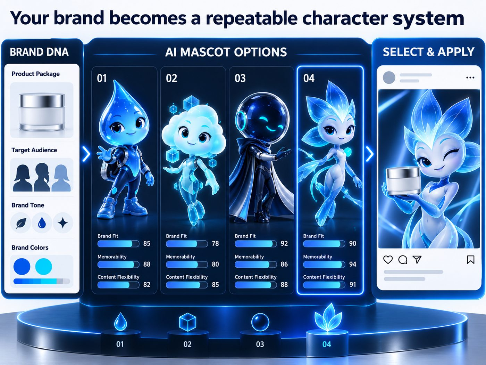 | [https://geben147-create.github.io/trusta-studio/assets/work/character-system.jpg](https://geben147-create.github.io/trusta-studio/assets/work/character-system.jpg) |
| 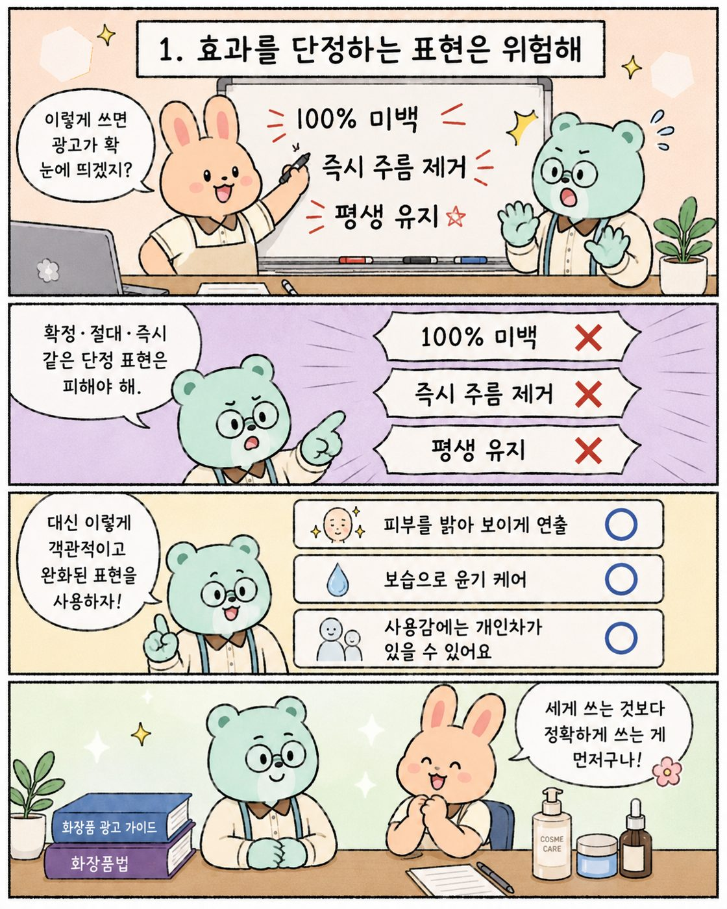 | [https://geben147-create.github.io/trusta-studio/assets/work/sns-guide.jpg](https://geben147-create.github.io/trusta-studio/assets/work/sns-guide.jpg) |
|  | [https://geben147-create.github.io/trusta-studio/assets/work/sns-webtoon-1.jpg](https://geben147-create.github.io/trusta-studio/assets/work/sns-webtoon-1.jpg) |
| 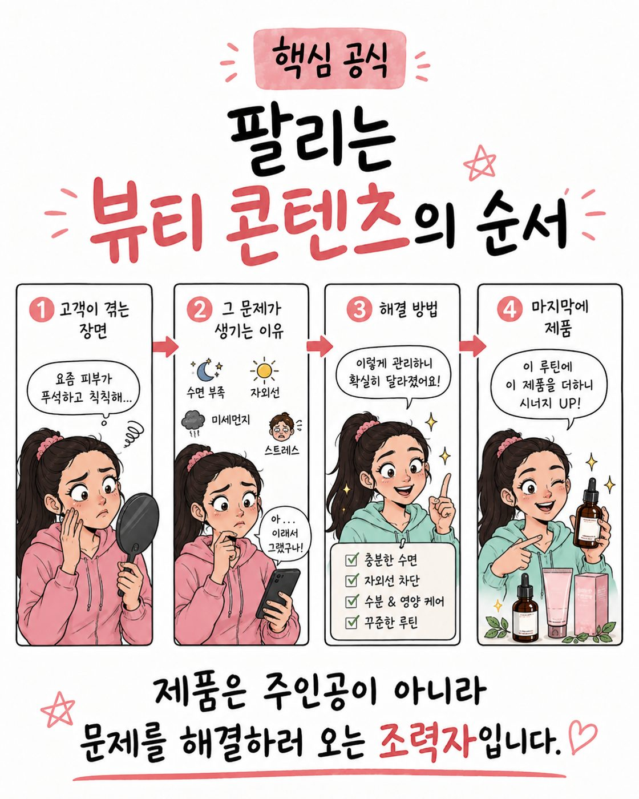 | [https://geben147-create.github.io/trusta-studio/assets/work/sns-webtoon-2.jpg](https://geben147-create.github.io/trusta-studio/assets/work/sns-webtoon-2.jpg) |
| 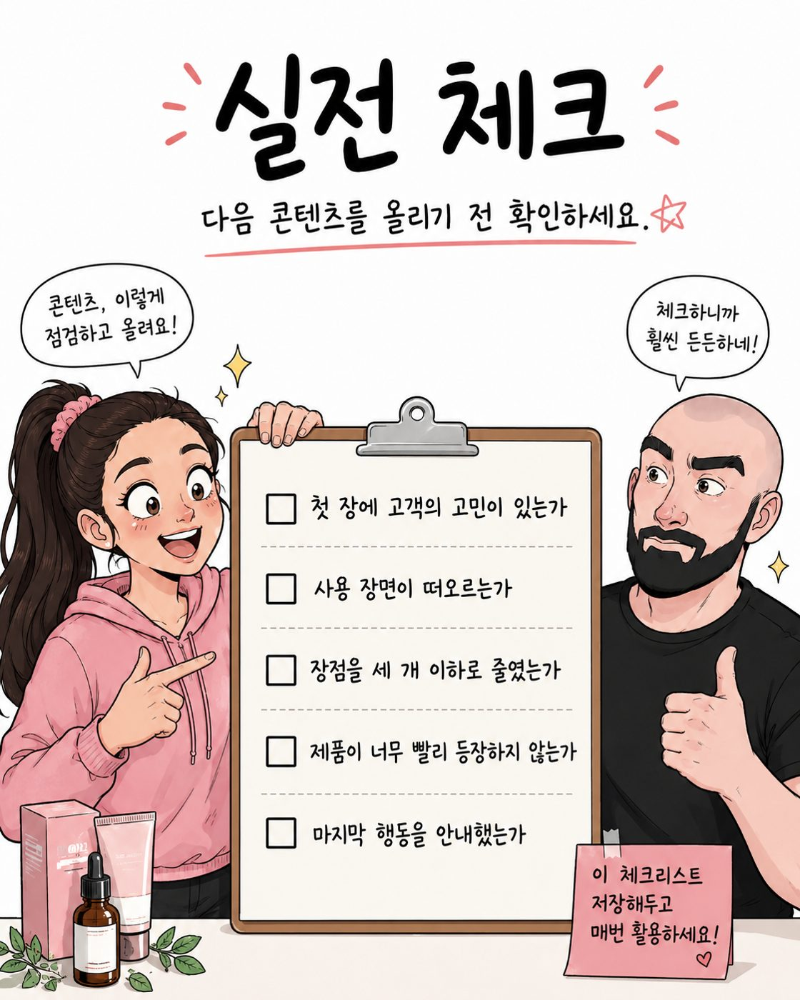 | [https://geben147-create.github.io/trusta-studio/assets/work/sns-webtoon-3.jpg](https://geben147-create.github.io/trusta-studio/assets/work/sns-webtoon-3.jpg) |
| 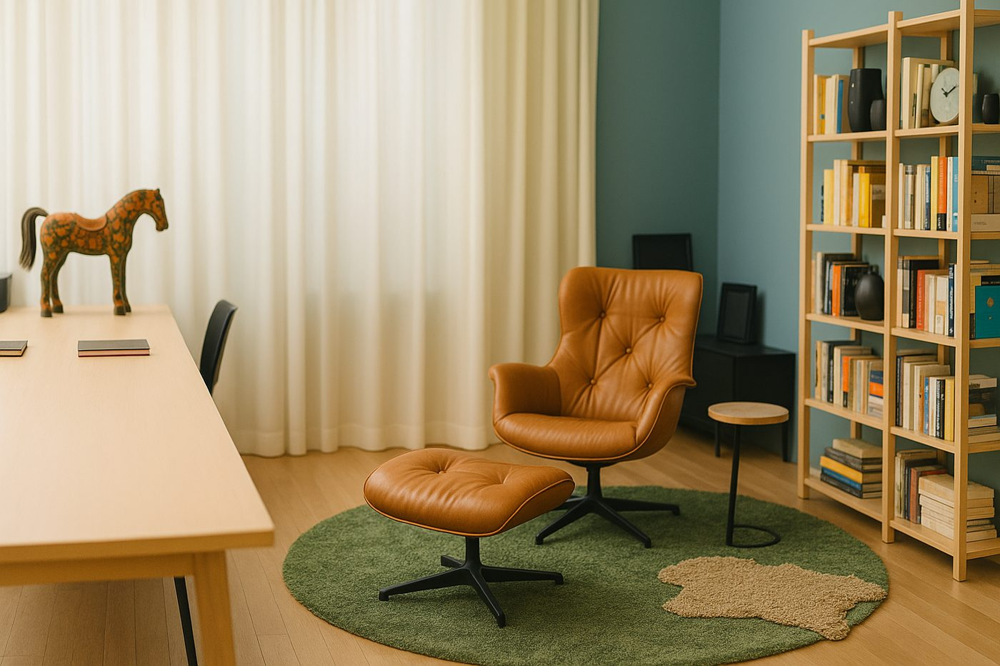 | [https://geben147-create.github.io/trusta-studio/assets/work/space-interior.jpg](https://geben147-create.github.io/trusta-studio/assets/work/space-interior.jpg) |
|  | [https://geben147-create.github.io/trusta-studio/assets/work/web-kbeauty.jpg](https://geben147-create.github.io/trusta-studio/assets/work/web-kbeauty.jpg) |
| 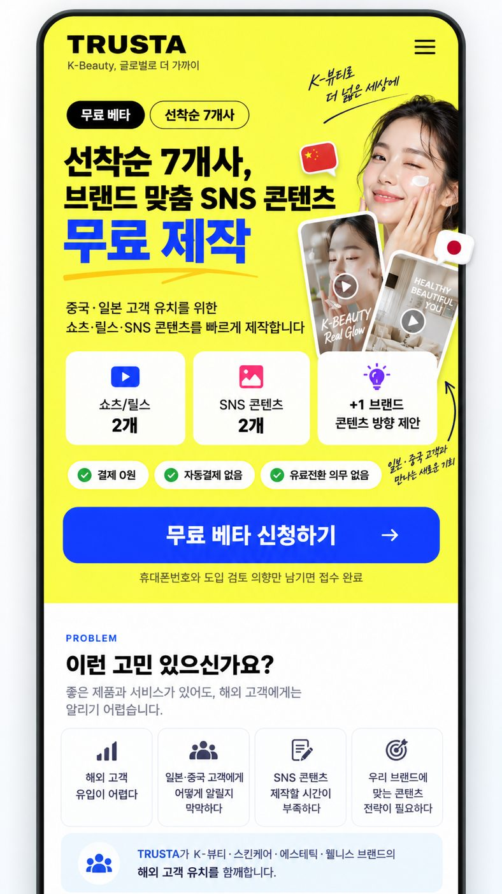 | [https://geben147-create.github.io/trusta-studio/assets/work/web-landing-mobile.jpg](https://geben147-create.github.io/trusta-studio/assets/work/web-landing-mobile.jpg) |

## 4. 파일 경로 (GitHub)

| 대상 | 주소 |
|---|---|
| 저장소 | [https://github.com/geben147-create/trusta-studio](https://github.com/geben147-create/trusta-studio) |
| `index.html` | [https://github.com/geben147-create/trusta-studio/blob/main/index.html](https://github.com/geben147-create/trusta-studio/blob/main/index.html) |
| `video.html` | [https://github.com/geben147-create/trusta-studio/blob/main/video.html](https://github.com/geben147-create/trusta-studio/blob/main/video.html) |
| `wadiz/index.html` | [https://github.com/geben147-create/trusta-studio/blob/main/wadiz/index.html](https://github.com/geben147-create/trusta-studio/blob/main/wadiz/index.html) |
| `assets/site.css` | [https://github.com/geben147-create/trusta-studio/blob/main/assets/site.css](https://github.com/geben147-create/trusta-studio/blob/main/assets/site.css) |
| `assets/trusta-logo.svg` | [https://github.com/geben147-create/trusta-studio/blob/main/assets/trusta-logo.svg](https://github.com/geben147-create/trusta-studio/blob/main/assets/trusta-logo.svg) |
| `assets/video/` | [https://github.com/geben147-create/trusta-studio/tree/main/assets/video](https://github.com/geben147-create/trusta-studio/tree/main/assets/video) |
| `assets/work/` | [https://github.com/geben147-create/trusta-studio/tree/main/assets/work](https://github.com/geben147-create/trusta-studio/tree/main/assets/work) |
| 변경 기록 | [https://github.com/geben147-create/trusta-studio/commits/main](https://github.com/geben147-create/trusta-studio/commits/main) |
| 전체 파일 ZIP 받기 | [https://github.com/geben147-create/trusta-studio/archive/refs/heads/main.zip](https://github.com/geben147-create/trusta-studio/archive/refs/heads/main.zip) |

## 5. 디자인 참고 사이트

| 사이트 | 주소 | 참고한 구조 |
|---|---|---|
| Plus X | [https://www.plus-ex.com/about](https://www.plus-ex.com/about) | 서비스 분류 (자동 접속에서 화면 분석 못함) |
| BUCK | [https://buck.co/work](https://buck.co/work) | 상단 소개문, 2열 작업 카드, 분야 필터 |
| Ordinary People | [https://ordinarypeople.info/](https://ordinarypeople.info/) | 헤더, 3단 프로젝트 배치 |
| studio fnt | [https://studiofnt.com/Projects](https://studiofnt.com/Projects) | 검정 배경 4열 목록 |
| HMS Studio | [https://hms.studio/](https://hms.studio/) | 어두운 영상 전용 페이지 |

## 6. 요청별 상태

| 번호 | 요구 | 상태 | 비고 |
|---|---|---|---|
| 1 | 기존 자료 찾아서 사용 | 🟡부분 | 이미지·영상·와디즈 페이지·로고 사용. PPT는 미반영 |
| 2 | 레퍼런스 5곳 참고 | 🟡부분 | Plus X 화면 분석 못함 |
| 3 | 분야별 섹터 구성 | ✅완료 | [메인](https://geben147-create.github.io/trusta-studio/) |
| 4 | 내 캐릭터·영상·디자인 연결 | 🟡부분 | 출처 확인이 필요한 자료는 제외 |
| 5 | 타이포·여백·움직이는 첫 화면 | ✅완료 | [메인](https://geben147-create.github.io/trusta-studio/) |
| 6 | 일반 홈페이지와 와디즈 구분 | ✅완료 | [와디즈](https://geben147-create.github.io/trusta-studio/wadiz/) 상품 내용은 예전 그대로 |
| 7 | 영상 별도 메뉴 | ✅완료 | [영상 페이지](https://geben147-create.github.io/trusta-studio/video.html) |
| 8 | 가짜 고객사·실적 금지 | 🟡부분 | 수치가 보이는 이미지 제외. 시안 속 문구·혜택은 디자인 예시 |
| 9 | 문의 연결 | ❌미완료 | 연락처 필요 |
| 10 | 광고 영상 6종 | ❌미완료 | 아직 시작 안 함 |
| 11 | 영상 편집 판매 페이지 (가격·전후 비교) | ❌미완료 | 아직 시작 안 함 |

## 알아둘 점

- 회사명 TRUSTA STUDIO는 임시입니다.
- 화면 속 문구·수치·혜택은 디자인 예시이며 현재 모집·실적이 아닙니다.
- 영상 속 상표는 각 소유자의 것이며 협찬·고객사가 아닙니다.
